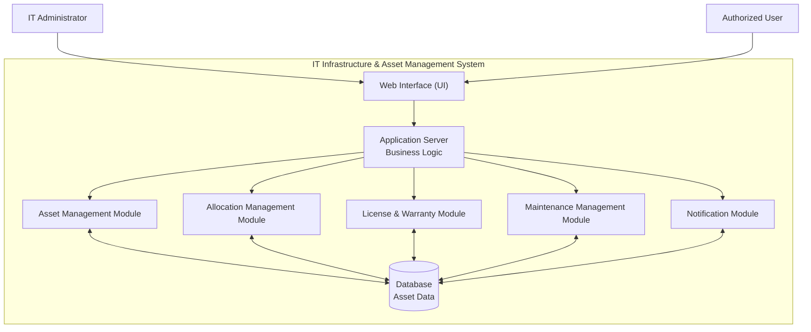

# 3.3 Component (UML) Diagram

The following UML component diagram represents the proposed major components of the IT Infrastructure & Asset Management System and their relationships. It illustrates how users interact with the user interface, how requests are processed by the application logic, and how the system manages asset-related information.

## Proposed Component Diagram

## Diagram Explanation

The proposed architecture consists of the following major components:

1. **Web Interface (UI):** Provides the interface through which administrators and authorized users interact with the system.
2. **Application Server (Business Logic):** Processes requests, validates input, applies business rules, and coordinates the functional modules.
3. **Asset Management Module:** Handles asset registration, searching, viewing, and updating.
4. **Allocation Management Module:** Manages asset allocation, availability, return, and reassignment.
5. **License & Warranty Module:** Stores and manages software license and hardware warranty information.
6. **Maintenance Management Module:** Maintains maintenance records and status information.
7. **Notification Module:** Identifies upcoming expiry and maintenance events and supports alerts.
8. **Database:** Stores asset records and related allocation, license, warranty, maintenance, and user information.

The arrows represent proposed interactions between components. The final interfaces, database relationships, and communication mechanisms will be confirmed during implementation. The diagram does not imply that these components have already been developed.

