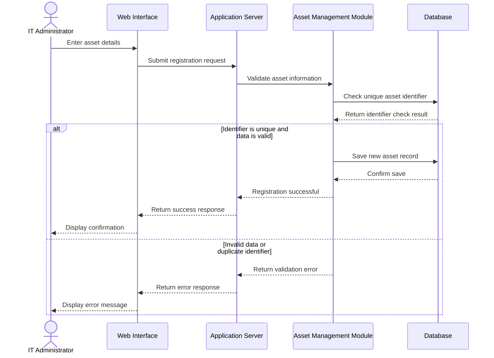
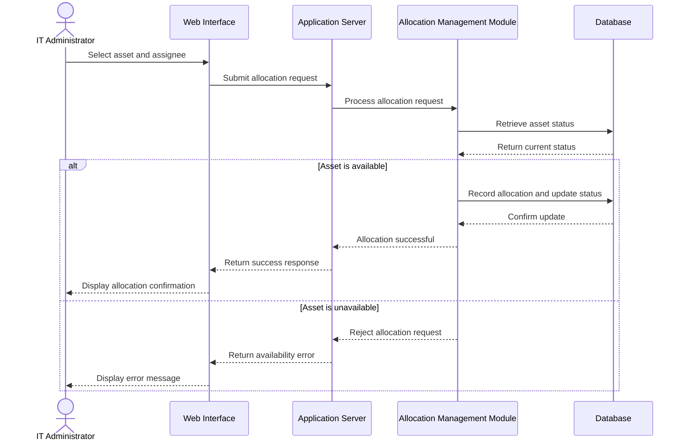

# 4.2 UML Sequence Diagrams

UML sequence diagrams illustrate the interactions between users and system components over time. The following diagrams represent two important workflows in the proposed IT Infrastructure & Asset Management System.

These diagrams describe the planned system behaviour and should be updated if the final implementation differs.

## 4.2.1 Sequence Diagram — Asset Registration

This diagram illustrates how an IT Administrator registers a new asset. The system validates the submitted information and checks for duplicate asset identifiers before saving the record.

**Explanation:** The administrator submits asset details through the interface. The application validates the information and checks the identifier before saving the record. If validation fails or the identifier already exists, the system should display an appropriate error instead of confirming successful registration.

## 4.2.2 Sequence Diagram — Asset Allocation

This diagram illustrates how an IT Administrator allocates an available asset to a user. The system checks asset availability before recording the allocation.

**Explanation:** The administrator selects an asset and the intended assignee. The system checks whether the asset is available. If available, it records the allocation and updates the asset status. Otherwise, it rejects the request and displays an appropriate message.

## 4.2.3 Design Considerations

- Asset identifiers should be unique to prevent duplicate asset records.
- Asset availability should be checked before an allocation is confirmed.
- Database updates should maintain consistency between allocation records and asset status.
- Failed operations should return clear error messages.
- The final implementation should handle concurrent requests so that the same asset is not allocated to multiple users simultaneously.

These diagrams describe the intended workflows. Actual behaviour must be verified through implementation and testing.
